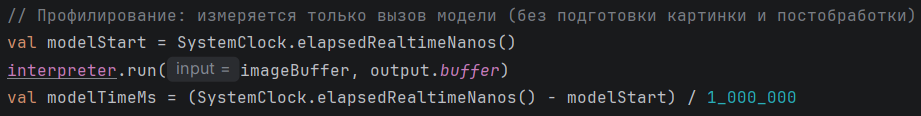
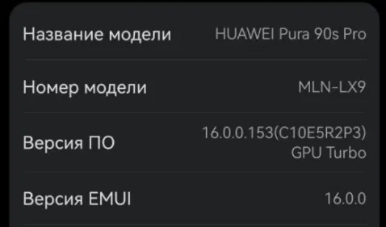
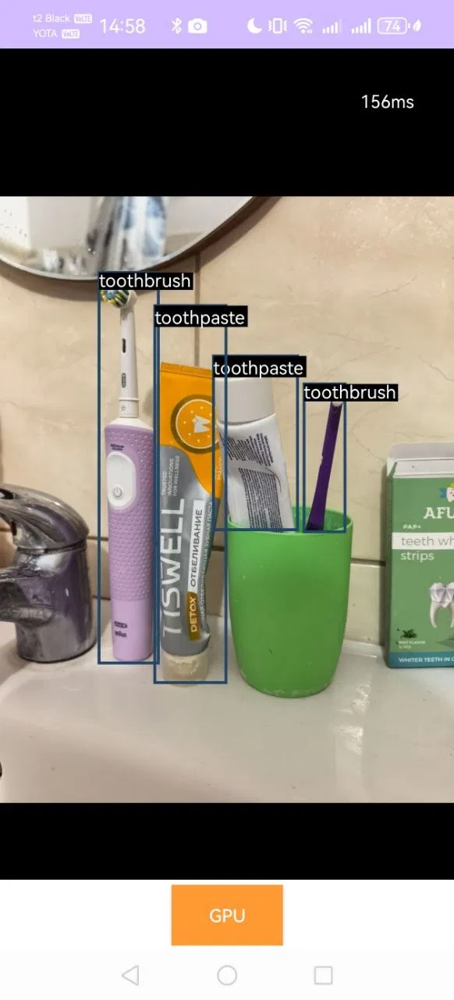
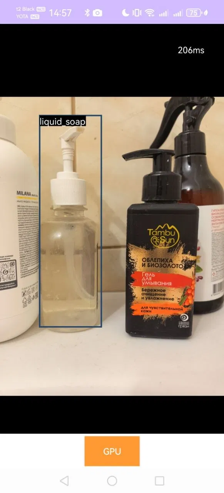

# Профилирование модели на Android

## 1. Что измеряется

Время одного вызова модели `interpreter.run(imageBuffer, output.buffer)` в `Detector.kt`. Замер через `SystemClock.elapsedRealtimeNanos()` сразу до и после вызова. Предобработка кадра (resize, нормализация, перестановка NCHW) и постобработка (NMS, отрисовка) в это время **не входят**.

Фрагмент кода (вставь как есть):

```kotlin
val modelStart = SystemClock.elapsedRealtimeNanos()
interpreter.run(imageBuffer, output.buffer)
val modelTimeMs = (SystemClock.elapsedRealtimeNanos() - modelStart) / 1_000_000
```

Значение выводится на экране приложения (`MainActivity.kt`: `inferenceTime`).

**Фрагмент `Detector.kt` с замером времени вокруг `interpreter.run` в Android Studio.**

.

## 2. Условия эксперимента

| Параметр | Значение |
|---|---|
| Устройство (модель телефона, SoC) | HUAWEI Pura 90s Pro, модель MLN-LX9, SoC - HiSilicon Kirin 9030S |
| Версия Android | EMUI 16 (на базе Android 16) |
| Модель | `best.tflite` (YOLO26n, 4 класса), размер файла 9,43 МБ |
| Вход модели | 640×640, float32, NCHW |
| Режим | CPU, 4 потока (`setNumThreads(4)`), GPU-делегат отключён |
| Что измеряется | только вызов `interpreter.run` (без предобработки и NMS) |
| Число замеров | 23 |

**Экран «О телефоне»**

.

## 3. Результаты на CPU

Значения, собранные покадрово:

| № | мс | № | мс | № | мс | № | мс |
|---|---|---|---|---|---|---|---|
| 1 | 156 | 7 | 149 | 13 | 147 | 19 | 165 |
| 2 | 173 | 8 | 148 | 14 | 146 | 20 | 202 |
| 3 | 146 | 9 | 145 | 15 | 151 | 21 | 147 |
| 4 | 149 | 10 | 153 | 16 | 150 | 22 | 153 |
| 5 | 148 | 11 | 146 | 17 | 148 | 23 | 147 |
| 6 | 155 | 12 | 150 | 18 | 158 | | |

| Статистика | Значение |
|---|---|
| Среднее | 153.6 мс |
| Медиана | 149 мс |
| Минимум | 145 мс |
| Максимум | 202 мс |
| Стандартное отклонение | 12.5 мс |
| FPS (1000 / среднее) | ≈ 6.5 |

**Приложение работает на устройстве, в кадре распознанные предметы с рамками и подписями, в углу видно время вызова модели в мс.**

.

**Ещё один кадр с другими предметами**

.

## 4. Выводы

Среднее время вызова модели на CPU составило около 150 мс (≈6.5 кадра в секунду), разброс небольшой, единичные пики до 202 мс. Этого достаточно для демонстрации детекции по камере, но недостаточно для плавного видео в реальном времени. Ускорить можно GPU-делегатом, снижением входного размера (например, 416×416) или квантизацией INT8. GPU-делегат в приложении отключён, потому что при включении приложение работало нестабильно, поэтому замеры сделаны на CPU.
